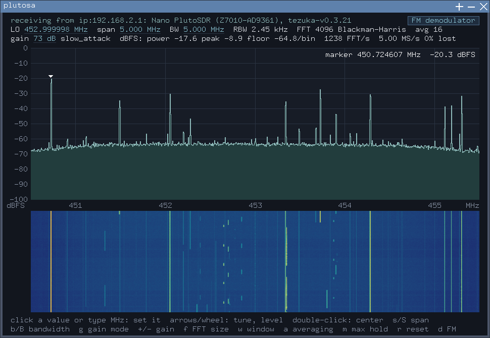
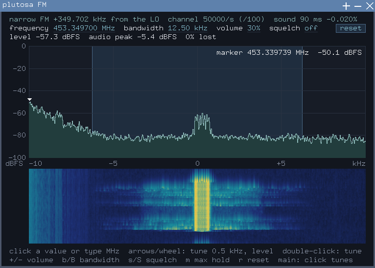

# plutosa


A spectrum analyzer and narrow FM receiver for the
[ADALM-Pluto](https://wiki.analog.com/university/tools/pluto),
written as a windowed app for [RitterOS](https://github.com/eloyr77/RitterOS).
It talks to the Pluto's `iiod` over its USB network link through
[ritteros-libiio](https://github.com/eloyr77/ritteros-libiio), and does all
of its signal processing itself, in plain C (with an AVX2 FFT where the
processor has it).



*At 453 MHz with a 5 MHz span on a RitterOS laptop: every sample arrives
(0% lost), 1238 FFTs of 4096 points a second.*

## What it does

**The main window**: the spectrum of everything the Pluto receives.

- A live spectrum with dB and MHz axes, a peak marker, max hold, and a
  waterfall below it.
- The receiver's settings: center frequency (LO), span (the sample rate,
  2.5 to 56 MHz), RF bandwidth, gain mode (slow/fast attack, hybrid, manual)
  and manual gain. Click a value to type a new one; it is checked against
  the Pluto's own ranges and read back.
- FFT of 1024, 4096 or 16384 points; Hann, Blackman-Harris or flat-top
  window; averaging over 1, 4, 16 or 64 frames.
- How many samples the link really carries ("5.00 MS/s (0% lost)").

**The FM window** (key `d`, or `-f MHZ` at the start): a narrow FM channel
taken out of the full-rate stream, without changing the Pluto's settings.

- The channel's own spectrum (±10 kHz), with the filter's band shaded.
- Frequency (anywhere inside the span; a click on the main window's plot
  tunes it), bandwidth (1 to 20 kHz), volume, and a squelch (on the
  channel's level, in dBFS, or off).
- Audio at 48 kHz through `/dev/pcm0`, kept in step with the sound card's
  clock.



*The FM window on a narrow FM channel at 453.3497 MHz: the carrier in the
middle of the 12.5 kHz filter, and in the waterfall the sidebands of a
transmission a moment before.*

## What it needs

- A RitterOS machine (x86-64) with its window system (`windowd`) running,
  and its SDK (`/system/sdk`).
- An ADALM-Pluto (or PlutoNano) on USB, its USB network set to **CDC-NCM**
  (RitterOS has no RNDIS driver): on the Pluto, `fw_setenv
  usb_ethernet_mode ncm`, then restart it. The Pluto is then
  `ip:192.168.2.1`.

How much of the spectrum is gap-free depends on the link: on the machines
it was tested on, spans up to about 7 MHz arrive without losses. Wider spans
work but lose samples between blocks (shown as a percentage), which a
spectrum hardly notices and FM audio does.

## Building and installing

plutosa is built on the RitterOS machine itself, with its own compiler and
SDK. From another computer, the Makefile copies only the app's code there
over ssh and runs `make` there:

```sh
git clone --recurse-submodules https://github.com/eloyr77/plutosa.git
cd plutosa
make deploy HOST=root@ADDRESS SSH_OPTS="-i ~/.ssh/ritteros"
```

That builds it and installs the app bundle
`/system/x86_64/apps/plutosa.program/` (the program, its icon and its
menu entry). RitterOS's sshd takes Ed25519 keys only; the SDK guide
(`sdk/CLAUDE.md` in RitterOS) tells how to install one.

On the RitterOS machine itself, `make deploy` in a copy of this directory
does the same.

## Running

Choose **Pluto spectrum analyzer** in the desktop menu (a right-click on
the desktop), or in a terminal:

```sh
plutosa                      # the Pluto at ip:192.168.2.1
plutosa ip:192.168.2.1 -f 145.5   # with the FM window open at 145.5 MHz
plutosa -p /tmp/view         # also writes both windows' pictures every 5 s (PPM)
```

### Keys

| Main window | |
|---|---|
| click a value, or type a number | set the LO, span, bandwidth or gain (MHz, dB) |
| arrows, wheel | tune by a tenth of the span; move the reference level |
| double-click | center there |
| `s` / `S` | span up / down |
| `b` / `B` | RF bandwidth up / down |
| `g` | gain mode |
| `+` / `-` | manual gain by 3 dB |
| `f`, `w`, `a` | FFT size, window, averaging |
| `m` | max hold |
| `r` | reset the measurements |
| `d` | the FM window |

| FM window | |
|---|---|
| click a value, or type a number | set the frequency (MHz), bandwidth (kHz), volume (%), squelch (dBFS) |
| arrows, wheel | tune by 0.5 kHz; move the reference level |
| double-click | tune there |
| `+` / `-` | volume |
| `b` / `B` | channel bandwidth |
| `s` / `S` | squelch on (3 dB over the present level) or up / down; type `off` to turn it off |
| `m`, `r` | max hold, reset |

## Tests

```sh
make check                                  # the FFT and the demodulator, on this computer
make check-machine HOST=root@ADDRESS        # the same, built with RitterOS's compiler there
make check-radio HOST=root@ADDRESS          # the receiver settings on the real Pluto
```

`tests/dsptest.c` checks the FFT against a direct DFT and the windows
against published values, both the plain C and the AVX2 code, and the two
against each other. `tests/demodtest.c` puts made signals through the
demodulator: tones, filter responses, FM tones, the squelch. Each check was
proven by planting a bug it must catch.

## Layout

| Path | What |
|---|---|
| `src/plutosa.c` | the app: threads, windows, keys and mouse |
| `src/view.c` | drawing a window: text, spectrum, waterfall |
| `src/radio.c` | the receiver's settings through libiio |
| `src/dsp.c` | FFT, windows, averaging, max hold, peaks (plain C and AVX2) |
| `src/demod.c` | the narrow FM demodulator |
| `tests/` | the tests above, and `streamtest.c`, which measures the link |
| `libiio/` | ritteros-libiio, a git submodule |

`CLAUDE.md` has the project's working notes: the design, the measurements
and the decisions behind them.

## Licence

GPL-3.0 (`LICENSE`).
